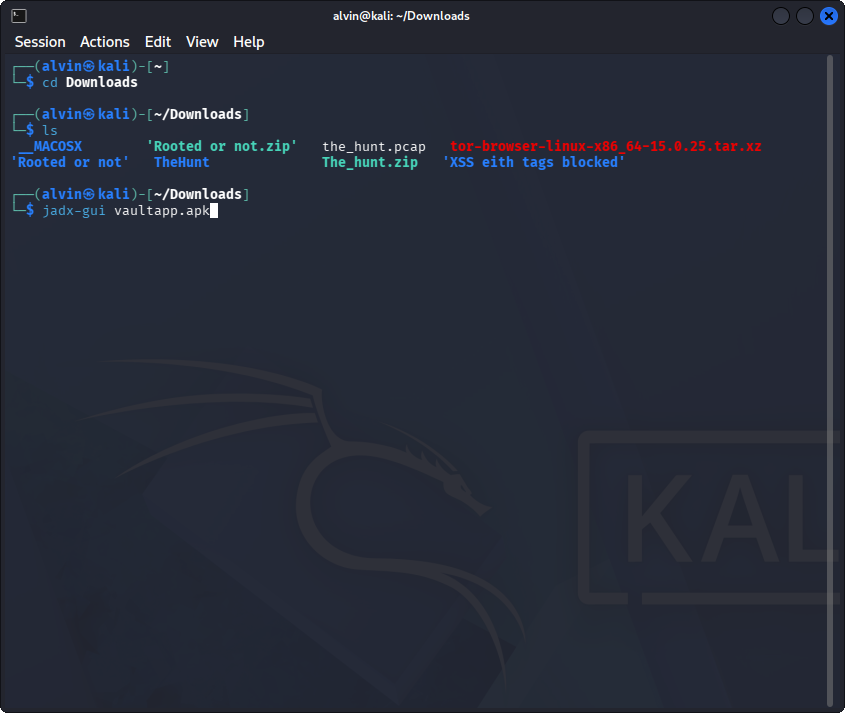
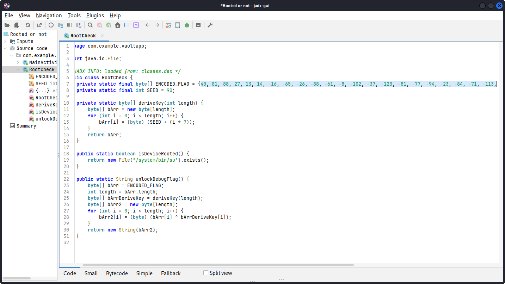

# Rooted-or-not-rooted-ctf

A detailed walkthrough for solving the **Rooted or Not** Android CTF challenge using static analysis and a custom decryption script.

The APK is `vaultapp.apk`.

---

## Walkthrough

### Step 1: Opening the APK

First, I navigated to the directory containing the challenge file and opened the application using `jadx-gui` to inspect its source code and resources:

```bash
cd Downloads
jadx-gui vaultapp.apk
```



### Step 2: Decompiling and Code Analysis

Once loaded in `jadx-gui`, I analyzed the application structure. Specifically, I inspected the `RootCheck` class to understand how root detection (`isDeviceRooted`) is implemented and where the encoded flag is stored.



### Step 3: Decrypting the Flag

Using the key derivation logic and the encoded byte array extracted from `RootCheck.java`, I wrote a Python script to replicate the XOR operation and decrypt the flag:

```python
# Replicate the Java key derivation and XOR logic
encoded_flag = [40, 81, 88, 27, 13, 14, -16, -65, -26, -88, -61, -8, -102, -37, -120, -81, -77, -94, -23, -84, -71, -113, -115]
seed = 90
length = len(encoded_flag)

derived_key = [(seed + (i * 7)) & 0xFF for i in range(length)]
flag = "".join(chr(((encoded_flag[i] & 0xFF) ^ derived_key[i])) for i in range(length))

print(f"Flag: {flag}")
```


Running the script successfully revealed the flag:

```text
Flag: r00t{st4t1c_4n4lys1s_byp4ss3s_th3_ch3ck}
```
